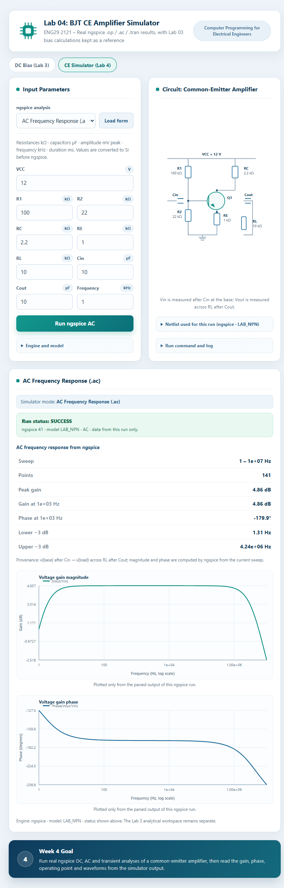
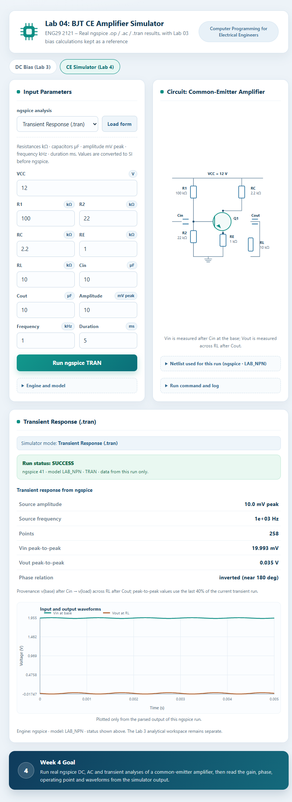
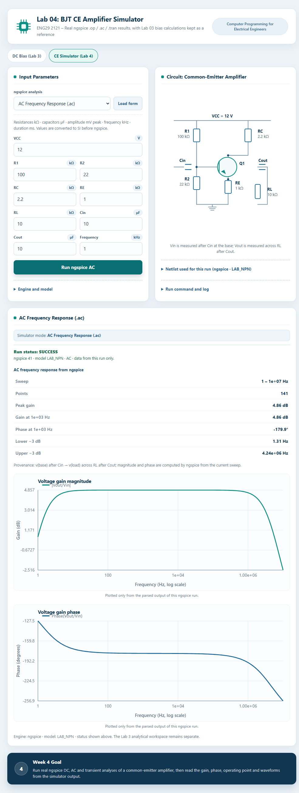

# Lab 03 / 04 — BJT DC Bias + CE Amplifier Simulator

Flask Web Application สำหรับคำนวณ **DC Operating Point** ของวงจร BJT
Common-Emitter สามแบบ ภายใต้สมมติฐาน Forward-Active (β และ VBE คงที่)
และเพิ่ม **Lab 04 CE Amplifier Simulator** ที่รัน ngspice จริง (`.op`, `.ac`, `.tran`)
แล้วแสดง operating point, Bode plot และ waveform จากผลจำลองรอบปัจจุบันเท่านั้น

> ผล SPICE แยกออกจากค่าอ้างอิงเชิงวิเคราะห์ของ Lab 3 อย่างชัดเจน
> หน้าเว็บแสดง engine, model, run status, provenance และ netlist ที่ใช้จริง

| โหมด | อุปกรณ์ไบอัส |
|---|---|
| Voltage Divider Bias (จาก Lab 02) | R1, R2, RE |
| Fixed Bias | RB |
| Emitter Bias (แหล่งจ่ายเดียว) | RB, RE |

## GitHub และ Commit

- Repository: https://github.com/tanakitnakboonma/Lab-3
- โฟลเดอร์งาน: root ของ repository (เนื้อหาของ `lab03/` ทั้งหมด)
- Commit ของ Lab 03: commit ล่าสุดบน branch `main` (ดูแท็บ Commits)
- Commit ของ Lab 04: `feat(lab04): add real ngspice CE amplifier simulator` (ดู `git log -1`)

## ภาพหน้าจอ

Voltage Divider (A1):


อินพุตผิด RB = 0 (A5):


Lab 04 — AC Bode plot จาก ngspice จริง (B4):



Lab 04 — transient ที่ 10 mV peak, 1 kHz (B5):



Lab 04 — UI polish ด้วย Impeccable (ก่อน / หลัง):




รายละเอียด detector, Lighthouse และหลักฐาน 390 px: `docs/impeccable-review.md`

## โครงสร้างโปรเจกต์

```
(รากของ repository นี้)
├── app.py                  # Flask routes: /, /calculate, /simulate + แปลงหน่วย
├── dc_bias.py              # pure engineering calculations (3 modes, ไม่ imports Flask)
├── spice_engine.py         # adapter ไปยัง ngspice: validate, netlist, run, parse
├── charts.py               # สร้าง SVG จากข้อมูลตัวเลขที่ parse ได้เท่านั้น
├── templates/index.html    # workspace Bias / Simulator + results + provenance
├── static/style.css        # responsive layout, tabs, charts
├── tests/                  # unittest เท่านั้น (50 tests รวม integration จริง)
├── requirements.txt        # Flask
├── README.md
├── AGENTS.md               # AI coding conventions
└── docs/
    ├── validation.md           # A1–A5 (Lab 03) + B1–B8 (Lab 04)
    ├── browser-*.png/jpeg      # หลักฐานจาก Browser จริง
    └── superpowers/...
```

## สิ่งที่ต้องมี

- Python 3.10 ขึ้นไป (ทดสอบด้วย Python 3.10.11 ใน `.venv`)
- Flask 3.1.3 (`requirements.txt`)
- **ngspice** สำหรับ `/simulate` (ไม่จำเป็นสำหรับหน้า DC Bias Lab 3)
  ทดสอบด้วย ngspice-41 CLI (`ngspice_con.exe`)
- Git (ถ้าต้องการ clone repository)
- ไม่ต้องใช้ Node.js หรือ Playwright สำหรับการรันแอป

## ติดตั้งและรัน (Windows PowerShell)

```powershell
python -m venv .venv
.venv\Scripts\Activate.ps1
python -m pip install -r requirements.txt
python -m flask --app app run --port 5050
```

เปิด `http://127.0.0.1:5050/` ใน Browser

> ใช้พอร์ต 5050 เพราะระหว่างพัฒนา พอร์ต 5000 มี Flask ของ Lab 02 ค้างอยู่
> ถ้าพอร์ต 5000 ว่างสามารถใช้ `--port 5000` ได้ และปรับ URL ให้ตรงกัน

### ngspice สำหรับ Lab 04 (Windows, แบบพกพา)

เครื่องที่ใช้พัฒนาติดตั้งแบบพกพาจาก conda-forge เพราะ Chocolatey ถูก UAC ปฏิเสธ
และ SourceForge ตอบ 403:

```powershell
$url = 'https://conda.anaconda.org/conda-forge/win-64/ngspice-exe-41-h295a5eb_0.conda'
Invoke-WebRequest $url -OutFile "$env:TEMP\ngspice.conda"
# แตกไฟล์ .conda ด้วย 7-Zip/conda package extractor แล้ว copy
# Library\bin\ngspice_con.exe ไปยัง C:\Users\<user>\AppData\Local\ngspice-conda\app\Library\bin\
```

`find_ngspice()` จะหา `NGSPICE_BINARY` ก่อน ตามด้วย `PATH` และ path ด้านบน
ดังนั้นควรตั้งก่อนรัน server ทุกครั้ง:

```powershell
$env:NGSPICE_BINARY = 'C:\Users\<user>\AppData\Local\ngspice-conda\app\Library\bin\ngspice_con.exe'
python -m flask --app app run --port 5050
```

> ใช้ `ngspice_con.exe` (batch/console) ไม่ใช่ `ngspice.exe` แบบ GUI
> ถ้าไม่ตั้ง `NGSPICE_BINARY` และหา engine ไม่พบ หน้า `/simulate` จะแสดง error
> ภาษาไทยและ **ไม่แสดงผลสำเร็จหรือกราฟเก่า**

## ติดตั้งและรัน (macOS / Linux)

```bash
python3 -m venv .venv
source .venv/bin/activate
python -m pip install -r requirements.txt
python -m flask --app app run --port 5050
```

สำหรับ Lab 04 ให้ติดตั้ง ngspice (`brew install ngspice` หรือ `sudo apt install ngspice`)
แล้วตั้ง `NGSPICE_BINARY=/path/to/ngspice` ถ้า executable ไม่ได้อยู่ใน `PATH`

## วิธีใช้

1. เลือก **Bias circuit** แล้วกด **Load form** — ฟอร์มจะแสดงเฉพาะช่องของโหมดนั้น
2. กรอกค่า (ตัวต้านทานเป็น kΩ, แรงดันเป็น V) แล้วกด **Calculate DC Bias**
3. ผลลัพธ์ระบุโหมดและหน่วย: `VB, VE, VC, VCE` (V), `IC, IE` (mA), `IB` (µA)
   พร้อมสถานะ `Forward Active` / `Cutoff` / `Saturation`

RB = 1 MΩ ให้กรอก `1000` (kΩ)

### Lab 04 — CE Simulator

1. เปิดแท็บ **CE Simulator (Lab 4)** หรือ `http://127.0.0.1:5050/?workspace=simulator`
2. เลือก `ngspice analysis`: `DC Operating Point (.op)` / `AC Frequency Response (.ac)` /
   `Transient Response (.tran)` แล้วกด **Load form** หากต้องการโหลดค่าเริ่มต้น
3. กรอกค่าวงจร Reference (kΩ, µF, V) และสำหรับ AC/TRAN ใส่ frequency/amplitude/duration
4. กด **Run ngspice …** แล้วอ่าน `Run status`, engine, model และ provenance
5. ผล DC แยกจาก “Lab 3 analytical reference — not SPICE” เสมอ
   ผล AC มี gain (dB) / phase (degrees) vs frequency (Hz, log scale)
   ผล TRAN มี Vin/Vout vs time (s, V) พร้อม summary phase relation

ค่าเริ่มต้นที่ใช้ตรวจ: VCC 12 V, R1 100 kΩ, R2 22 kΩ, RC 2.2 kΩ,
RE 1 kΩ, RL 10 kΩ, Cin/Cout 10 µF, source 10 mV peak @ 1 kHz, duration 5 ms

## รัน Automated Tests

จากรากของ repository นี้ (โฟลเดอร์ที่มี `app.py`):

```powershell
python -m unittest discover -s tests -v
```

ถ้าอยู่ใน repo รวมของรายวิชา (`gitlab/`) ให้รันจาก root แทน:

```powershell
python -m unittest discover -s lab03/tests -t lab03 -v
```

ผลที่คาด: **50 tests ผ่านทั้งหมด** — 12 tests เดิมของ Lab 02/03 ยังยืนยันว่า
Voltage Divider ไม่เสีย, มี tests ของ `spice_engine.py` (validation, netlist,
parser, timeout/nonzero/empty/stale-output), web simulator tests และ integration
test ที่รัน ngspice จริง 3 analysis เมื่อพบ executable

```powershell
# ต้องการให้ integration test รันจริง ให้ตั้ง path ก่อน (ถ้าไม่มีจะถูก skip)
$env:NGSPICE_BINARY = 'C:\Users\<user>\AppData\Local\ngspice-conda\app\Library\bin\ngspice_con.exe'
```

## อินพุตและผลลัพธ์

| อินพุต | หน่วย | โหมดที่ใช้ | ความหมาย |
|---|---|---|---|
| VCC | V | ทั้งหมด | แรงดันเลี้ยงวงจร |
| R1 | kΩ | Divider | ตัวต้านทาน VCC–Base |
| R2 | kΩ | Divider | ตัวต้านทาน Base–Ground |
| RB | kΩ | Fixed, Emitter | ตัวต้านทาน VCC–Base |
| RC | kΩ | ทั้งหมด | ตัวต้านทาน VCC–Collector |
| RE | kΩ | Divider, Emitter | ตัวต้านทาน Emitter–Ground |
| β | — | ทั้งหมด | อัตราขยายกระแส (hFE) |
| VBE | V | ทั้งหมด | แรงดัน Base–Emitter |

## สมการที่ใช้

```
ทุกโหมด   IC  = β·IB
          IE  = (β+1)·IB
          VB  = VE + VBE
          VC  = VCC − IC·RC
          VCE = VC − VE

Fixed     IB  = (VCC − VBE) / RB
          VE  = 0

Emitter   IB  = (VCC − VBE) / (RB + (β+1)·RE)
          VE  = IE·RE

Divider   VTH = VCC·R2 / (R1 + R2)
          RTH = R1·R2 / (R1 + R2)
          IB  = (VTH − VBE) / (RTH + (β+1)·RE)
          VE  = IE·RE
```

## ค่าตัวอย่าง (A1–A5)

VCC = 12 V, RC = 2.2 kΩ, β = 100, VBE = 0.70 V

| ID | โหมด | อินพุต | IC ที่ควรได้ | VCE ที่ควรได้ |
|---|---|---|---|---|
| A1 | Divider | R1 100, R2 22, RE 1 kΩ | 1.2299 mA | 8.0521 V |
| A2 | Fixed | RB 1000 kΩ | 1.1300 mA | 9.5140 V |
| A3 | Emitter | RB 1000, RE 1 kΩ | 1.0263 mA | 8.7055 V |
| A4 | Emitter | RB 1000, RE 2 kΩ | 0.9401 mA | 8.0328 V |
| A5 | Fixed | RB 0 | error (RB > 0) | — |

ผลตรวจจริงจาก Browser พร้อมหลักฐาน: `docs/validation.md`

## ข้อจำกัดของแบบจำลอง

- ใช้ Forward-Active Approximation เท่านั้น (β และ VBE คงที่)
- ไม่คิด Early effect, temperature, AC small-signal หรือ transient
- ถ้า `IB ≤ 0` (Divider รวมถึง `VTH ≤ VBE`) → `Cutoff` + warning
- ถ้า `VCE < 0.2 V` → `Saturation` + warning
- ค่าที่อยู่นอก Active Region ไม่ควรนำไปใช้โดยไม่ตรวจสอบซ้ำ

### ข้อจำกัดของ SPICE side

- ใช้ BJT `LAB_NPN` (Gummel-Poon แบบสอน) ไม่ใช่ part number จริง
- `.ac` เป็น small-signal frequency response, `.tran` เป็น large-signal time domain
  จึงให้ข้อมูลคนละแบบและต้องไม่นำมาหยดแทนกัน
- ผลจะถูกแสดงก็ต่อเมื่อ subprocess สำเร็จและ parse ผ่านในรอบนั้นเท่านั้น
- กราฟ SVG ถูกสร้างจากตัวเลขที่ parse จาก output จริง ไม่ใช่ mock plot

## การตรวจผ่าน Browser และ MCP

ใบงานต้องการตรวจ A1–A5 ผ่าน Browser จริง โดยใช้ Playwright MCP เป็นเส้นทางหลัก

- เครื่องที่ใช้ทำ Lab นี้ไม่มี `node`/`npx` ใน PATH จึงรัน Playwright MCP ไม่ได้
- ใช้ **OpenCode Browser tool** ในตัว OpenCode Desktop แทน (Chromium จริง)
  และรายงานวิธีจริงเป็น `OpenCode Browser` ตามข้อ fallback ของใบงาน
- Playwright MCP บันทึกเป็น `NOT RUN` พร้อมเหตุผลใน `docs/validation.md`
- ไม่ได้เพิ่ม `@playwright/test` หรือ dependency ใด ๆ ใน `requirements.txt`
- Lab 03 ตรวจ A1–A5; Lab 04 ตรวจ B1–B8 (DC/AC/TRAN, เปลี่ยน RE, เปลี่ยน source,
  invalid input, desktop/390 px UI) และบันทึกผล/ภาพจริงใน `docs/validation.md`
- B8 ใช้ iframe 390 CSS px แทนการย่อหน้าต่างจริงเพราะ browser tool ไม่ยอม
  `resizeTo`; บันทึกเป็น 390 px emulation ตามความจริง

## หมายเหตุความปลอดภัย

- Flask development server ใช้เฉพาะเครื่องพัฒนา (`127.0.0.1`)
- ห้าม commit `.venv/`, `.env`, API keys หรือ credentials
- ตรวจ `git status` และ `git diff --staged` ก่อน push ทุกครั้ง

## เอกสารและหลักฐานตามเกณฑ์ประเมิน

| เกณฑ์ | หลักฐานใน repository |
|---|---|
| โครงสร้างและ Python (แยกฟังก์ชัน, เลือกตามโหมด, dict) | `dc_bias.py`, `app.py`, `docs/design-note.md` §2–§5 |
| วิศวกรรมและการคงผลเดิม | `docs/validation.md` §1 และ §7 B1, `tests/` (50 tests), ค่า A1 ตรงกับ Lab 02 |
| ตรวจฟอร์มและผลจาก Browser | `docs/validation.md` §2 และ §7, `docs/browser-*.jpeg/png` |
| UI และ Impeccable ก่อน/หลัง | `docs/impeccable-review.md`, `docs/impeccable-before-desktop.png`, `docs/impeccable-after-desktop.png`, `docs/impeccable-after-mobile-390px.png`; detector `[]`, Lighthouse 1.00/1.00/1.00 |
| จำลองจริง ไม่ใช่ค่า hard-code | `spice_engine.py`, `docs/validation.md` §7 (B2–B7), netlist + log + trace ที่เปลี่ยนตาม input |
| ส่งงานและทำซ้ำได้ | `README.md`, GitHub URL + commit SHA, `docs/superpowers/` |

## แก้ปัญหาที่พบบ่อย

| อาการ | วิธีแก้ |
|---|---|
| `Address already in use` | พอร์ตถูกใช้อยู่ เปลี่ยน `--port 5051` และใช้ URL นั้นทุกครั้ง |
| เปิดเว็บแล้วเห็น Lab 02 | มี Flask ตัวเก่าค้างที่พอร์ตนั้น ปิด process เดิมหรือเปลี่ยนพอร์ต |
| `flask: command not found` | ยังไม่ activate venv หรือยังไม่ `pip install -r requirements.txt` |
| เปิดไฟล์ `templates/index.html` ตรง ๆ แล้วคำนวณไม่ได้ | ต้องรันผ่าน Flask server เพราะคำนวณที่ Python backend |
| เลือกโหมดแล้วช่องไม่เปลี่ยน | ต้องกด **Load form** (ฟอร์มโหลดใหม่จาก server ไม่ใช้ JavaScript) |
| หน้าเว็บแสดง error ภาษาไทย | เป็น validation ตามที่ออกแบบ ให้แก้ค่าตามข้อความ |
| `/simulate` บอก “ไม่พบ ngspice” | ตั้ง `NGSPICE_BINARY` ให้ชี้ `ngspice_con.exe` หรือใส่ executable ใน `PATH` แล้ว restart server |
| หน้า simulator ค้างที่ผลเก่า | ต้องมี `Run status: SUCCESS` รอบปัจจุบัน; error/timeout จะลบ results ก่อนแสดงเสมอ |
| `ngspice.exe` เปิดแล้วค้าง | ใช้ `ngspice_con.exe` แบบ batch ตามคำสั่งใน README |
