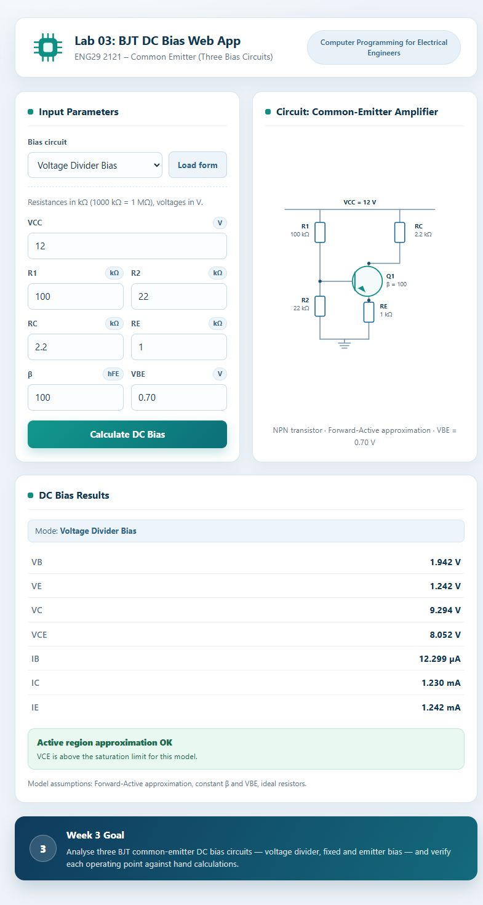
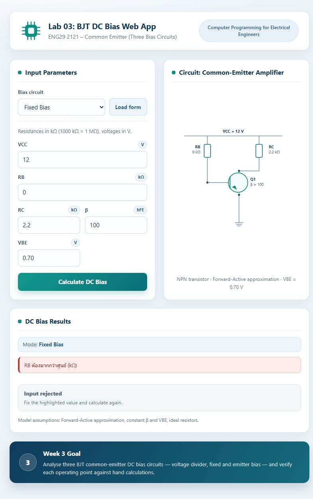

# Lab 03 — BJT DC Bias Web App (three bias circuits)

Flask Web Application สำหรับคำนวณ **DC Operating Point** ของวงจร BJT
Common-Emitter สามแบบ ภายใต้สมมติฐาน Forward-Active (β และ VBE คงที่)

| โหมด | อุปกรณ์ไบอัส |
|---|---|
| Voltage Divider Bias (จาก Lab 02) | R1, R2, RE |
| Fixed Bias | RB |
| Emitter Bias (แหล่งจ่ายเดียว) | RB, RE |

## GitHub และ Commit

- Repository: https://github.com/tanakitnakboonma/gitlab
- โฟลเดอร์งาน: `lab03/`
- Commit ของ Lab 03: `4d80defc9060844e010a5ab31beb71066b8eb685`

## ภาพหน้าจอ

Voltage Divider (A1):



อินพุตผิด RB = 0 (A5):



## โครงสร้างโปรเจกต์

```
lab03/
├── app.py                  # Flask routes, mode dispatch, kΩ → Ω
├── dc_bias.py              # pure engineering calculations (3 functions)
├── templates/index.html    # mode select + per-mode form + results
├── static/style.css        # responsive layout and presentation
├── tests/                  # ชุดทดสอบเดิมของ Lab 02 (24 tests, regression)
├── requirements.txt        # Flask
├── README.md
├── AGENTS.md               # AI coding conventions
└── docs/
    ├── lab03-assignment.html   # ใบงาน Lab 03
    ├── design-note.md          # สถาปัตยกรรม/สมการ/สมมติฐาน
    ├── validation.md           # ค่าอ้างอิสระ + ผลตรวจ A1–A5
    ├── brainstorm.md           # ทางเลือกและเหตุผล (Lab 02 → Lab 03)
    ├── browser-a1-divider.jpeg # หลักฐานจาก Browser (A1)
    └── browser-a5-fixed-rb0.jpeg # หลักฐานจาก Browser (A5)
```

## สิ่งที่ต้องมี

- Python 3.10 ขึ้นไป (ทดสอบด้วย Python 3.14.2)
- Flask 3.1.3 (`requirements.txt`)
- Git (ถ้าต้องการ clone repository)
- ไม่ต้องใช้ Node.js หรือ Playwright สำหรับการรันแอป

## ติดตั้งและรัน (Windows PowerShell)

```powershell
cd lab03
python -m venv .venv
.venv\Scripts\Activate.ps1
python -m pip install -r requirements.txt
python -m flask --app app run --port 5050
```

เปิด `http://127.0.0.1:5050/` ใน Browser

> ใช้พอร์ต 5050 เพราะระหว่างพัฒนา พอร์ต 5000 มี Flask ของ Lab 02 ค้างอยู่
> ถ้าพอร์ต 5000 ว่างสามารถใช้ `--port 5000` ได้ และปรับ URL ให้ตรงกัน

## ติดตั้งและรัน (macOS / Linux)

```bash
cd lab03
python3 -m venv .venv
source .venv/bin/activate
python -m pip install -r requirements.txt
python -m flask --app app run --port 5050
```

## วิธีใช้

1. เลือก **Bias circuit** แล้วกด **Load form** — ฟอร์มจะแสดงเฉพาะช่องของโหมดนั้น
2. กรอกค่า (ตัวต้านทานเป็น kΩ, แรงดันเป็น V) แล้วกด **Calculate DC Bias**
3. ผลลัพธ์ระบุโหมดและหน่วย: `VB, VE, VC, VCE` (V), `IC, IE` (mA), `IB` (µA)
   พร้อมสถานะ `Forward Active` / `Cutoff` / `Saturation`

RB = 1 MΩ ให้กรอก `1000` (kΩ)

## รัน Automated Tests

จากในโฟลเดอร์ `lab03/`:

```powershell
python -m unittest discover -s tests -v
```

หรือจาก root ของ repository:

```powershell
python -m unittest discover -s lab03/tests -t lab03 -v
```

ผลที่คาด: **24 tests ผ่านทั้งหมด** — เป็นชุดทดสอบเดิมของ Lab 02 ที่ยืนยันว่า
Voltage Divider ยังให้ผลเหมือนเดิม (งาน Lab 03 ตรวจด้วย Browser ตามใบงาน
ไม่เพิ่ม unittest ใหม่)

## อินพุตและผลลัพธ์

| อินพุต | หน่วย | โหมดที่ใช้ | ความหมาย |
|---|---|---|---|
| VCC | V | ทั้งหมด | แรงดันเลี้ยงวงจร |
| R1 | kΩ | Divider | ตัวต้านทาน VCC–Base |
| R2 | kΩ | Divider | ตัวต้านทาน Base–Ground |
| RB | kΩ | Fixed, Emitter | ตัวต้านทาน VCC–Base |
| RC | kΩ | ทั้งหมด | ตัวต้านทาน VCC–Collector |
| RE | kΩ | Divider, Emitter | ตัวต้านทาน Emitter–Ground |
| β | — | ทั้งหมด | อัตราขยายกระแส (hFE) |
| VBE | V | ทั้งหมด | แรงดัน Base–Emitter |

## สมการที่ใช้

```
ทุกโหมด   IC  = β·IB
          IE  = (β+1)·IB
          VB  = VE + VBE
          VC  = VCC − IC·RC
          VCE = VC − VE

Fixed     IB  = (VCC − VBE) / RB
          VE  = 0

Emitter   IB  = (VCC − VBE) / (RB + (β+1)·RE)
          VE  = IE·RE

Divider   VTH = VCC·R2 / (R1 + R2)
          RTH = R1·R2 / (R1 + R2)
          IB  = (VTH − VBE) / (RTH + (β+1)·RE)
          VE  = IE·RE
```

## ค่าตัวอย่าง (A1–A5)

VCC = 12 V, RC = 2.2 kΩ, β = 100, VBE = 0.70 V

| ID | โหมด | อินพุต | IC ที่ควรได้ | VCE ที่ควรได้ |
|---|---|---|---|---|
| A1 | Divider | R1 100, R2 22, RE 1 kΩ | 1.2299 mA | 8.0521 V |
| A2 | Fixed | RB 1000 kΩ | 1.1300 mA | 9.5140 V |
| A3 | Emitter | RB 1000, RE 1 kΩ | 1.0263 mA | 8.7055 V |
| A4 | Emitter | RB 1000, RE 2 kΩ | 0.9401 mA | 8.0328 V |
| A5 | Fixed | RB 0 | error (RB > 0) | — |

ผลตรวจจริงจาก Browser พร้อมหลักฐาน: `docs/validation.md`

## ข้อจำกัดของแบบจำลอง

- ใช้ Forward-Active Approximation เท่านั้น (β และ VBE คงที่)
- ไม่คิด Early effect, temperature, AC small-signal หรือ transient
- ถ้า `IB ≤ 0` (Divider รวมถึง `VTH ≤ VBE`) → `Cutoff` + warning
- ถ้า `VCE < 0.2 V` → `Saturation` + warning
- ค่าที่อยู่นอก Active Region ไม่ควรนำไปใช้โดยไม่ตรวจสอบซ้ำ

## การตรวจผ่าน Browser และ MCP

ใบงานต้องการตรวจ A1–A5 ผ่าน Browser จริง โดยใช้ Playwright MCP เป็นเส้นทางหลัก

- เครื่องที่ใช้ทำ Lab นี้ไม่มี `node`/`npx` ใน PATH จึงรัน Playwright MCP ไม่ได้
- ใช้ **OpenCode Browser tool** ในตัว OpenCode Desktop แทน (Chromium จริง)
  และรายงานวิธีจริงเป็น `OpenCode Browser` ตามข้อ fallback ของใบงาน
- Playwright MCP บันทึกเป็น `NOT RUN` พร้อมเหตุผลใน `docs/validation.md`
- ไม่ได้เพิ่ม `@playwright/test` หรือ dependency ใด ๆ ใน `requirements.txt`

## หมายเหตุความปลอดภัย

- Flask development server ใช้เฉพาะเครื่องพัฒนา (`127.0.0.1`)
- ห้าม commit `.venv/`, `.env`, API keys หรือ credentials
- ตรวจ `git status` และ `git diff --staged` ก่อน push ทุกครั้ง

## เอกสารและหลักฐานตามเกณฑ์ประเมิน

| เกณฑ์ | หลักฐานใน repository |
|---|---|
| โครงสร้างและ Python (แยกฟังก์ชัน, เลือกตามโหมด, dict) | `dc_bias.py`, `app.py`, `docs/design-note.md` §2–§5 |
| วิศวกรรมและการคงผลเดิม | `docs/validation.md` §1, `tests/` (24 tests), ค่า A1 ตรงกับ Lab 02 |
| ตรวจฟอร์มและผลจาก Browser | `docs/validation.md` §2, `docs/browser-a1-divider.jpeg`, `docs/browser-a5-fixed-rb0.jpeg` |
| ส่งงานและทำซ้ำได้ | `README.md`, GitHub URL + commit SHA, `/docs/superpowers/` |

## แก้ปัญหาที่พบบ่อย

| อาการ | วิธีแก้ |
|---|---|
| `Address already in use` | พอร์ตถูกใช้อยู่ เปลี่ยน `--port 5051` และใช้ URL นั้นทุกครั้ง |
| เปิดเว็บแล้วเห็น Lab 02 | มี Flask ตัวเก่าค้างที่พอร์ตนั้น ปิด process เดิมหรือเปลี่ยนพอร์ต |
| `flask: command not found` | ยังไม่ activate venv หรือยังไม่ `pip install -r requirements.txt` |
| เปิดไฟล์ `templates/index.html` ตรง ๆ แล้วคำนวณไม่ได้ | ต้องรันผ่าน Flask server เพราะคำนวณที่ Python backend |
| เลือกโหมดแล้วช่องไม่เปลี่ยน | ต้องกด **Load form** (ฟอร์มโหลดใหม่จาก server ไม่ใช้ JavaScript) |
| หน้าเว็บแสดง error ภาษาไทย | เป็น validation ตามที่ออกแบบ ให้แก้ค่าตามข้อความ |
